# Tracking WebSphere Liberty deployments on OpenShift Container Platform using IBM License Service

 

**Last updated:** November 2026

**Status: ** Under development

**Duration:** 30 minutes

Need support? Contact **Lars Besselmann, Sebastian Porro**

## Overview
This lab provides fundamental hands-on experience with tracking WebSphere Liberty deployment on OpenSHift using Red Hat OpenShift. 

## Objective

The objectives of this lab are to:

  - Install IBM License Service

  - Deploy WebSphere Liberty instances using the WebSpere Liberty Operator

  - Apply anntations to make the WebSphere Liberty instances detectable

## Prerequisites

The following prerequisites must be completed prior to beginning this lab:

  - Familiarity with basic Linux commands

  - Have internet access

  - Access to the TechZone lab environment

## Accessing the lab environment

If you are doing this lab as part of an instructor led workshop (virtual or face to face), an environment has already been provisioned for you. The instructor will provide the details for accessing the lab environment.

Otherwise, you will need to reserve an environment for the lab. You can obtain one here. Follow the on-screen instructions for the “**Reserve now**” option.

[https://techzone.ibm.com/collection/liberty-getting-started-labs-demos/journey-liberty-deployment-on-open-shift](https://techzone.ibm.com/collection/liberty-getting-started-labs-demos/journey-liberty-deployment-on-open-shift)

The lab environment contains of a Desktop machine and several other VMs spinning up an OpenShift cluster five Linux VMs and an OpenShift cluster.

## Lab Tasks

In this lab, you will use IBM License Service to track the WebSphere Liberty deployments on Red Hat OpenShift.

**Main Steps:**
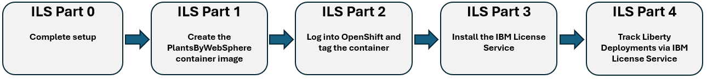

 

# Part 0: Complete setup

To simplify the lab and to allow you to focus on the migration, certain software and artifacts have already been put in place for you. These are as follows:

- **podman** (for creating and running images) has been installed

- **oc** (OpenShift command Line tool for running OCP commands) has been installed

- **IBM Semeru Java SDKs** 

- **git, maven and other tools**

- The **PlantsByWebSphere Sample Application**, built as an Enterprise Archive file (EAR) is provided via git repository.

 

To complete the setup, the git project must be downloaded and the PlantsByWebSphere application must be installed. The steps are only necessary if you did not perform them as part of the lab **Rapidly deploy and configure your Java applications with WebSphere Liberty and OpenShift Container Platform**

1. Create Student directory and clone the project repository

       mkdir -p ~/Student/temp
       git clone https://github.com/LarsBesselmann/LibertyGettingStarted-2026-OCP-Lab ~/Student/temp
       mv ~/Student/temp/lab_sources/* ~/Student
       rm -rf ~/Student/temp
       ls -lrt ~/Student
    

2. Create podman container with the PlantsByWebSphere database pbwdb

       cd ~/Student

       sudo podman build -t plantsdb-db2 ./plantsdb-db2

       sudo podman run --privileged=true -d \
        --name plantsdb-db2 \
        -p 50000:50000 \
        -e LICENSE=accept \
        -e DB2INST1_PASSWORD=db2password \
        -e DBNAME=PLANTSDB \
        -v plantsdb-data:/database \
        plantsdb-db2

        netstat -an | grep 50000

3. Get the migration plan

       cp ~/Student/ama/plantsbywebsphereee6.ear_migrationPlan.zip ~/Downloads/

4. Extract the migration plan.

       rm -rf ~/Student/migrationPlan
       mkdir ~/Student/migrationPlan
       cd ~/Student/migrationPlan
       cp ~/Downloads/plantsbywebsphereee6.ear_migrationPlan.zip .
       unzip plantsbywebsphereee6.ear_migrationPlan.zip

# Part 1: Create the PlantsByWebSphere container image    

## 1.1: Prepare the migration plan

1.	Add the PlantsByWebSphere binary file to your migration plan and remove the placeholder.

        cp ~/Student/plantsbywebsphereee6.ear ~/Student/migrationPlan/target

        rm ~/Student/migrationPlan/target/plantsbywebsphereee6.ear.placeholder

2.	Add the db2 library files to your migration plan and remove the placeholder.

        cp ~/Student/db2_drivers/* ~/Student/migrationPlan/src/main/liberty/lib  

        rm ~/Student/migrationPlan/src/main/liberty/lib/*.placeholder

3.	Update the server.xml file to adjust the database endpoint and JPA spec. 

        sed -i 's/vm-1/desktop-2/g' /home/itzuser/Student/migrationPlan/src/main/liberty/config/server.xml
        sed -i 's/jpa-2.1/jpa-2.0/g' /home/itzuser/Student/migrationPlan/src/main/liberty/config/server.xml

4.  Modify the "**Containerfile**" to specify a specific version of Liberty to deploy: in this case, **icr.io/appcafe/websphere-liberty:26.0.0.6-kernel-java8-openj9-ubi**

        sed -i 's/websphere-liberty:25.0.0.6-kernel-java8-openj9-ubi/websphere-liberty:26.0.0.6-kernel-java8-openj9-ubi/g' /home/itzuser/Student/migrationPlan/Containerfile

5. The `migration plan` is ready to be used to generate an image of your application running on WebSphere Liberty. To do this, you will use the **`Containerfile`** that comes with the migration plan.

## 1.2: Create the PlantsByWebSphere container

1.	Build the container image from the migration plan using podman

        cd ~/Student/migrationPlan

        podman build -f Containerfile --tag apps/pbw .

    - `-f` is the path to the `Containerfile` used to build the image
    - `--tag` allows you to define the name and version of the image to build
    - `.` is the "current directory" of the migration plan that includes the artifacts for building the container image. 

    The whole build process might take a couple of minutes.
    
2. Confirm the container image has been built

        podman images | grep apps/pbw

    

# Part 2: Log into OpenShift and tag the container

1. Login to OpenShift using your IBM ID 

        oc login -w --server=$OCP_CONSOLE_URL:6443

    A browser window will open where you need to log in via IBM ID.

2. Verify that the WebSphere Liberty Operator has been installed

        oc get operators -n openshift-operators | grep websphere-liberty

    The output should look like this:

    

    If nothing is returned, the WebSphere Liberty Operator is not installed and you must do it manually. To do so, perform the steps described in the **Appendix** and then continue here.

3. Create a new project where you will deploy the application 

        oc new-project apps-pbw

4. Login to the OpenShift internal registry so you can push the image 

        oc registry login

    The command will return the registry public hostname which should be similar to (but maybe with a different base URL)

    `default-route-openshift-image-registry.apps.itz-e1vpbd.infra01-lb.dal14.techzone.ibm.com`

5. Tag the container image using the following podman command

        imageReference="default-route-openshift-image-registry.${OCP_BASE_URL}/apps-pbw/pbw-app:1.0"
        echo $imageReference

        podman tag apps/pbw ${imageReference}

6. Verify the image was tagged

        podman images | grep pbw-app

    

7. Push the container image to OpenShift internal registry 

       imageReference="default-route-openshift-image-registry.${OCP_BASE_URL}/apps-pbw/pbw-app:1.0"
       echo $imageReference

       podman push ${imageReference}

In previous steps, you configured the sensitive data that is needed, accepted the license, pointed to the image that is needed to pull,  and logged into OpenShift. Now, with a single command, you can deploy to OpenShift and configure the image. 

You must specify which overlay will provide the configuration (dev in this case).

# Part 3: Install the IBM License Service

The IBM License Service is not installed by default. Here the steps to install it.

## How to install and use the IBM License Service (ILS)
You can track your Liberty runtime usage in a Kubernetes cluster with the IBM License Service by configuring your WebSphereLibertyApplication custom resource file or the YAML file of a Kubernetes resource Deployment. The values that you specify depend on which Liberty product edition you deploy, how it is licensed, and whether you are using the WebSphere Liberty operator.

In this example, you will first install the IBM License Service.
Then you will use the Liberty operator to deploy the PlantsByWebSphere application with license information (annotations) into the OpenShift cluster.

### Install the IBM License Service

1. Check if the IBM License Service is already installed:

    To verify the installation of License Service with CLI, run the following command:
	
       oc get deployment --all-namespaces | grep ibm-licensing-operator
    If a deployment is returned, ILS is already installed and you can skip the next steps

2. Install the ibm-licensing-catalog

    Execute the following comand to install the ILS catalog

       cat <<EOF | oc apply -f -
       apiVersion: operators.coreos.com/v1alpha1
       kind: CatalogSource
       metadata:
           name: ibm-licensing-catalog
           namespace: openshift-marketplace
       spec:
           displayName: IBM License Service Catalog
           publisher: IBM
           sourceType: grpc
           image: icr.io/cpopen/ibm-licensing-catalog
           updateStrategy:
               registryPoll:
                   interval: 45m
           grpcPodConfig:
               securityContextConfig: restricted
       EOF

    Output:

    `catalogsource.operators.coreos.com/ibm-licensing-catalog created`

3. Verify that the CatalogSource for your IBM License Service operator is created.

        oc get pods -n openshift-marketplace | grep licensing
        oc get catalogsource -n openshift-marketplace | grep licensing

4. Install the IBM License Service operator.

    1. Create a namespace for License Service.

            oc create namespace ibm-licensing

        Output: `namespace/ibm-licensing created`

    2. Create the operator group to deploy the OperatorGroup resource.

           cat <<EOF | oc apply -f -
           apiVersion: operators.coreos.com/v1
           kind: OperatorGroup
           metadata:
               name: licensing-og
               namespace: ibm-licensing
           spec:
               targetNamespaces:
               - ibm-licensing
           EOF

        Output: `operatorgroup.operators.coreos.com/licensing-og created`
 

    3. Create the subscription for License Service.

           export LS_CHANNEL=v4.2 
           cat <<EOF | oc apply -f -
           apiVersion: operators.coreos.com/v1alpha1
           kind: Subscription
           metadata:
             name: ibm-licensing-operator-app
             namespace: ibm-licensing
           spec:
             channel: $LS_CHANNEL
             installPlanApproval: Automatic
             name: ibm-licensing-operator-app
             source: ibm-licensing-catalog
             sourceNamespace: openshift-marketplace
           EOF

        Output: `subscription.operators.coreos.com/ibm-licensing-operator-app created`

    4. Verify that your License Service operator is installed:

           oc get pod -n ibm-licensing
 
        The licensing-operator pod should be shown as "Running". Otherwise wait and try again (It might take up to 15 minutes for all the pods to show the Running status.

    5. Update the License Service instance that was created during installation to accept the license.

           echo -e "
            spec:	\n
                license:	\n
                    accept: true	\
            " > accept-license.yaml

           cat accept-license.yaml

           oc patch IBMLicensing instance --type merge --patch-file accept-license.yaml
 
    6. Get the route of the IBM License Service

            oc get route -n ibm-licensing -o jsonpath='{range .items[*]}{.spec.host}{"\n"}{end}'

5. Get the authentication token

       export LICENSING_URL=$(oc get route -n ibm-licensing -o jsonpath='{range .items[*]}{.spec.host}{"\n"}{end}')

       export TOKEN=$(kubectl get secret ibm-licensing-token -n ibm-licensing -o jsonpath='{.data.token}' |base64 -d)

6. Get the URL of the status page

    To display the URL of the ILS status page including token, use the command:

       echo https://${LICENSING_URL}/status?token=${TOKEN}

    Access the status page via the command:

       /usr/bin/xdg-open "https://${LICENSING_URL}/status?token=${TOKEN}"

    After accepting the security warnings, you should see something like this:

    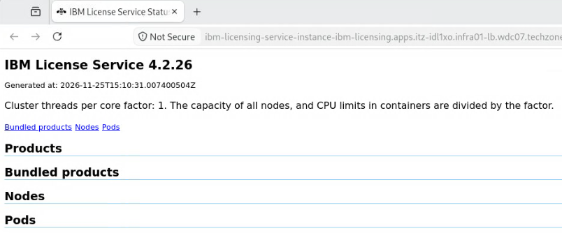

7. You can retrieve the licensing report .zip file by running:

       cd ~/Student
       timestamp=$(date +"%Y-%m-%d_%H_%M_%S")
       curl -k "https://${LICENSING_URL}/snapshot?token=${TOKEN}" --output report_$timestamp.zip

    Take a look at the content via the command:

       unzip -l report_*.zip

    The report.zip contains files like:
    - bundled_products_2026-10-25_2026-11-24_itz-mopxrw-master-1.csv
    - products_2026-10-25_2026-11-24_itz-mopxrw-master-1.csv
    - bundled_products_daily_2026-10-25_2026-11-24_itz-mopxrw-master-1.csv
    - products_daily_2026-10-25_2026-11-24_itz-mopxrw-master-1.csv
    - data_condition.txt
    - data_condition.json
    - unrecognized-apps-2026-10-25-2026-11-24.csv
    - signature.rsa
    - pub_key.pem
    - checksum.txt

Useful links how to install the IBM License Service: 
https://www.ibm.com/docs/en/cloud-paks/foundational-services/4.x?topic=service-installing-license)
https://www.ibm.com/docs/en/cloud-paks/foundational-services/4.x?topic=registry-installing-license-service-openshift-container-platform

# Part 4: Track Liberty Deployments via IBM License Service 

## 4.1: Adjust the Plants application configuration files 

1. Create a directory for the application configuration

       mkdir -p ~/Student/deploy/dev

       cp ~/Student/migrationPlan/deploy/kustomize/base/application-cr.yaml ~/Student/deploy/dev
       cp ~/Student/migrationPlan/deploy/kustomize/base/plantsbywebsphereee6-configmap.yaml ~/Student/deploy/dev
       cp ~/Student/migrationPlan/deploy/kustomize/overlays/dev/plantsbywebsphereee6-secret.yaml ~/Student/deploy/dev

2. Update the **plantsbywebsphereee6-secret.yaml** file. 

    1. Add the credentials

           cd ~/Student/deploy/dev
           sed -i 's/Dmgr01Node_DB2INST1_user: <REPLACE_WITH_BASE64_ENCODED_DATA>/Dmgr01Node_DB2INST1_user: ZGIyaW5zdDE=/g' plantsbywebsphereee6-secret.yaml

           sed -i 's/Dmgr01Node_DB2INST1_password: <REPLACE_WITH_BASE64_ENCODED_DATA>/Dmgr01Node_DB2INST1_password: ZGIycGFzc3dvcmQ=/g' plantsbywebsphereee6-secret.yaml

           sed -i 's/WIMUserRegistry_1_Default01Cell_userRegistry_primaryAdminId: <REPLACE_WITH_BASE64_ENCODED_DATA>/WIMUserRegistry_1_Default01Cell_userRegistry_primaryAdminId: d2FzYWRtaW4=/g' plantsbywebsphereee6-secret.yaml

    2. Review the final file:

           cat plantsbywebsphereee6-secret.yaml

        The output should look like this:

        

3.	Update the **plantsbywebsphereee6-configmap.yaml** file.

    1. Adjust the database endpoint

           cd ~/Student/deploy/dev
           sed -i 's/vm-1/desktop-2/g' plantsbywebsphereee6-configmap.yaml

    2. Review the final file:

           cat plantsbywebsphereee6-configmap.yaml

        The output should look like this:

        

4. Update the `application-cr.yaml` file
    
    1. Adjust the applicationImage

           cd ~/Student/deploy/dev
           echo $OCP_BASE_URL

           imageReference="default-route-openshift-image-registry.${OCP_BASE_URL}/apps-pbw\/pbw-app:1.0"
           echo $imageReference

           sed -i "s|IMAGE_REFERENCE|${imageReference}|g" application-cr.yaml

    2. Accept the license by setting `accept: true`

           sed -i 's/accept: false/accept: true/g' application-cr.yaml

    3. Review the updated **application-cr.yaml**
        
           cat ~/Student/deploy/dev/application-cr.yaml

        The output should look like this:

        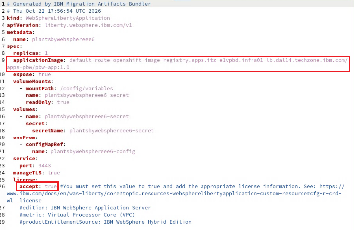

    Review also the rest of the file. 
    - **replicas** specifies the number of pods
    - **envFrom** specifies the configMap to be used
    - you could also specify the license information

    If you run into any trouble, you can copy the content from below (but need to adjust the applicationImage URL).

        # Generated by IBM Migration Artifacts Bundler
        # Thu Oct 22 17:56:54 UTC 2026
        kind: WebSphereLibertyApplication
        apiVersion: liberty.websphere.ibm.com/v1
        metadata:
            name: plantsbywebsphereee6
        spec:
            replicas: 1
            applicationImage: default-route-openshift-image-registry.apps.itz-e1vpbd.infra01-lb.dal14.techzone.ibm.com/apps-pbw/pbw-app:1.0
            expose: true
            volumeMounts:
            - mountPath: /config/variables
                name: plantsbywebsphereee6-secret
                readOnly: true
            volumes:
                - name: plantsbywebsphereee6-secret
                secret:
                    secretName: plantsbywebsphereee6-secret
            envFrom:
                - configMapRef:
                    name: plantsbywebsphereee6-config
            service:
                port: 9443
            manageTLS: true
            license:
                accept: true

    The updated `application-cr.yaml` in the **dev** directory is now complete. The PlantsByWebSphere application configuration is finalized.  

    ___

## 4.2: Deploy the Liberty application and track it using the IBM License Service (ILS)

Start from scratch without any deployment:

1. Access the ILS Status Page:

       export LICENSING_URL=$(oc get route -n ibm-licensing -o jsonpath='{range .items[*]}{.spec.host}{"\n"}{end}')

       export TOKEN=$(kubectl get secret ibm-licensing-token -n ibm-licensing -o jsonpath='{.data.token}' |base64 -d)

       /usr/bin/xdg-open "https://${LICENSING_URL}/status?token=${TOKEN}"

    The ILS Status page should show no Liberty instance.

    

    If you see any Liberty instances, delete the related deployments.

2. Create an OCP deployment for Liberty dev

       cd ~/Student/deploy
       oc apply -n apps-pbw -f dev/plantsbywebsphereee6-secret.yaml
       oc apply -n apps-pbw -f dev/plantsbywebsphereee6-configmap.yaml
       oc apply -n apps-pbw -f dev/application-cr.yaml

3. Verify the deployment

       oc get deployment -n apps-pbw

    Wait for the `deployment` to be ready and available, as illustrated below:

        NAME                   READY   UP-TO-DATE   AVAILABLE  
        plantsbywebsphereee6   1/1     1            1    

4. Reload the ILS Status page and it should show a Liberty instance.

    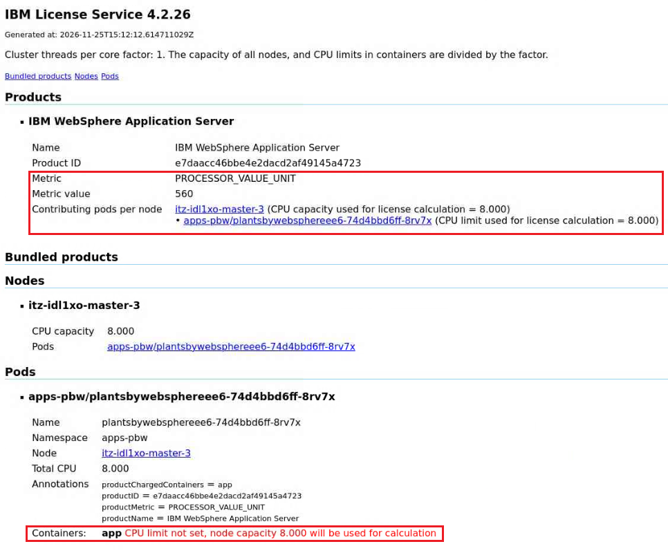
    
    Let's take a look at the information

    - The product is annotated for WebSphere Application Server which is based on PVUs.
    - The node has 8 cores
    - A CPU limit is not set, so the whole worker node will be licensed.
    - As each core is counted with 70 PVU, the metric value is 560.
    

5. Compare the findings with the deployment file.

       cat dev/application-cr.yaml

    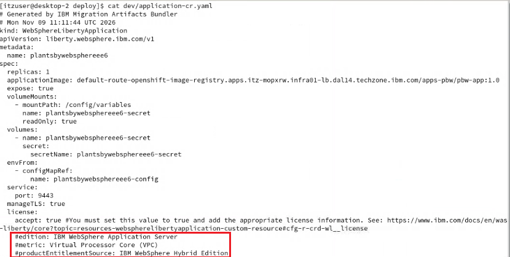

    - No edition has been specified
    - No entitlement has been specified
    - No CPU limit has been specified

6. Adjust the deployment to add entitlement details.

       cd ~/Student/deploy
       sed -i "s|#edition: IBM WebSphere Application Server|edition: IBM WebSphere Application Server|g" dev/application-cr.yaml
       sed -i "s|#metric: Virtual Processor Core (VPC)|metric: Virtual Processor Core (VPC)|g" dev/application-cr.yaml
       sed -i "s|#productEntitlementSource: IBM WebSphere Hybrid Edition|productEntitlementSource: IBM Enterprise Application Runtimes|g" dev/application-cr.yaml
       cat dev/application-cr.yaml
    
    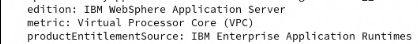

        
7. Apply the changes and see the results: 
   
       cd ~/Student/deploy
       oc apply -n apps-pbw -f dev/application-cr.yaml

    Reload the ILS Status page and take a look at the changes.

    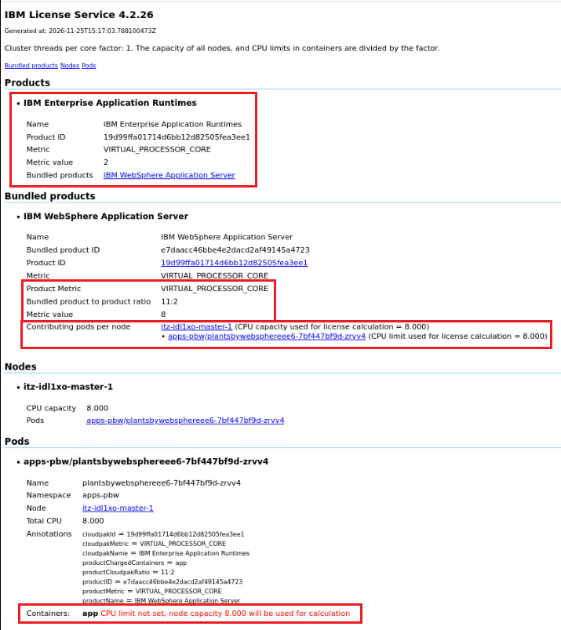
    
    - The product is annotated for WebSphere Application Server but now based on VPCs.
    - A CPU limit is not set, so the whole worker node (8 cores) will be licensed. This results in a WAS metric value of 8.
    - WAS Base has the ratio 11:2 within IBM Enterprise Application Runtimes (EAR), which means 11 deployed cores require 2 VPC of EAR.
    - As 8 WAS cores must be licensed and the ratio 11:2 is applied, the EAR metric value is 2.

8. Add a cpu limit to avoid that the whole worker node must be licensed.

    Go back to the open editor or open a new one.

       gedit ~/Student/deploy/dev/application-cr.yaml &

   Add the following 5 lines just the line after line 10:

       resources:
           requests:
               cpu: 300m
           limits:
               cpu: 800m
               memory: 512Mi

    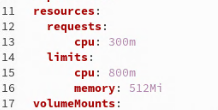

    Make sure that the number of spaces before `resources` is correct, otherwise the deployment will fail.
    Save the changes but keep the editor open.

9. Apply the changes and see the results: 
   
        cd ~/Student/deploy
        oc apply -n apps-pbw -f dev/application-cr.yaml

    Reload the ILS Status page and take a look at the changes.

    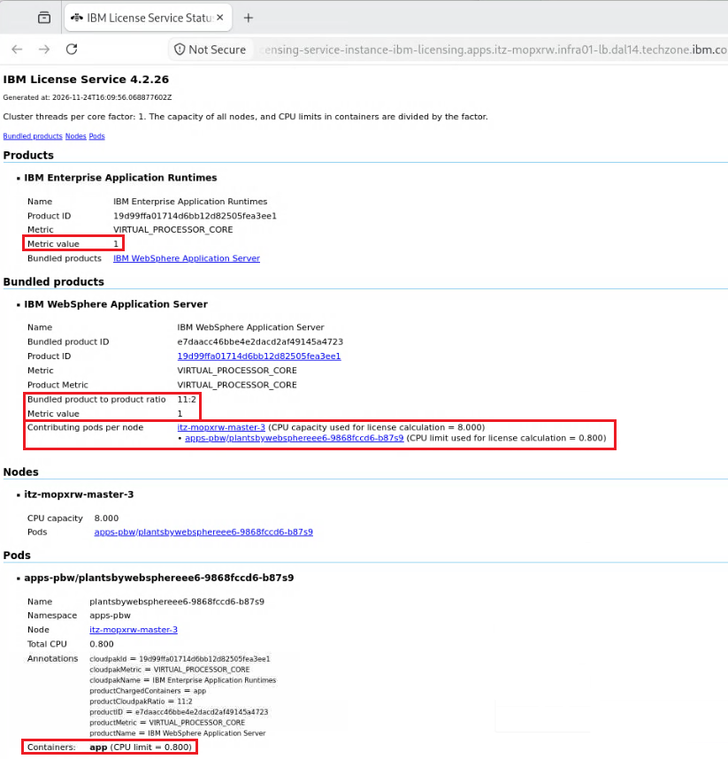
    
    - A CPU limit has been recognized, so only those cores will be licensed (here 0.8 cores).
    - The total number or cores running WebSphere Liberty Base is 0.8 which will be rounded up to 1 core, which results into a WAS metric value of 1.
    - As only 1 core must be licensed with WAS Base and the EAR ratio 11:2 is applied, the EAR metric value is 2.

10. Add additional replicas.

    Go back to the open editor or open a new one.

        gedit ~/Student/deploy/dev/application-cr.yaml &

    In line 8, change the number of replica to 5.

    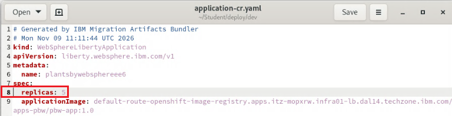

    Save the changes and feel free to close the editor.

11. Apply the changes and see the results: 
   
        cd ~/Student/deploy
        oc apply -n apps-pbw -f dev/application-cr.yaml

    Reload the ILS Status page and take a look at the changes.

    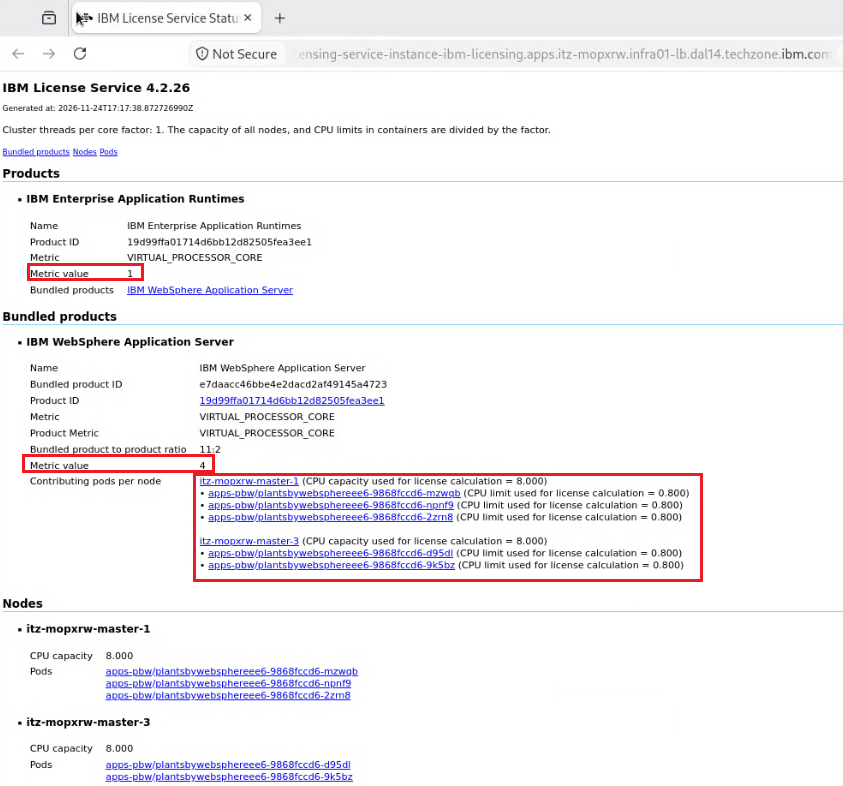
    
    - You can now see 5 pods that are contributing to the number of licenses, each with 0.8 cores.
    - The total number or cores running WebSphere Liberty Base is 4 (5 x 0.8) which results in a WAS metric value of 4.
    
    - As only 4 cores must be licensed with WAS Base and the ratio 11:2 is applied, the EAR metric value is 1.

## 4.3: Deploy another Liberty application and track it using the IBM License Service (ILS)

The current deployment assumes that the application requires Liberty Base entitlements. But in fact, in only requires WebSphere Liberty Core.

1. Review the **Technology Report** which is part of the migration plan and you will find out that the application only requires WebSphere Liberty Core.

       /usr/bin/xdg-open ~/Student/migrationPlan/reports/plantsbywebsphereee6.ear_TechnologyReport.html 

    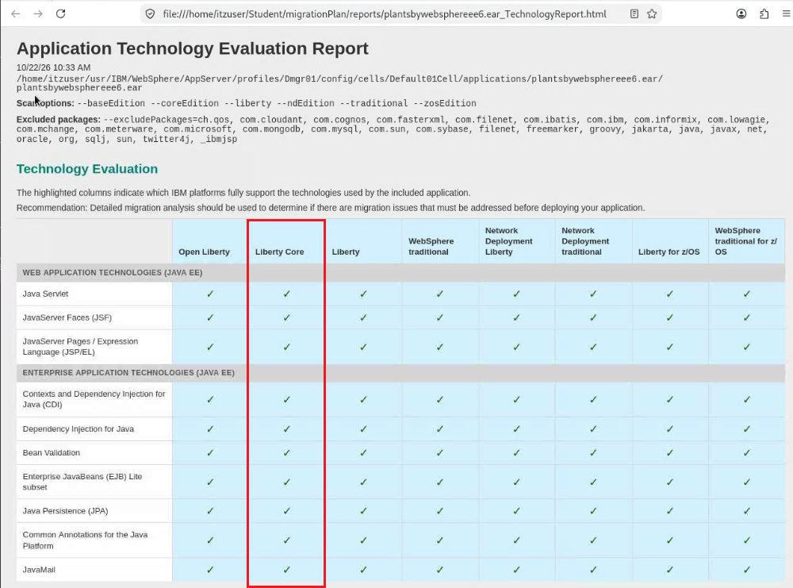

2. Let's create a second application and deployment, this time for Liberty Core.
 
    1. Duplicate the existing deployment yaml files

            cd ~/Student/deploy
            cp -r dev stage

    2. For the stage environment, change the deployment name

           sed -i '0,/name: plantsbywebsphereee6/s/name: plantsbywebsphereee6/name: plantsbywebsphereee6s/' stage/application-cr.yaml

    3. Adjust the application-cr.yaml to use Liberty Core only.

           sed -i "s|edition: IBM WebSphere Application Server|edition: IBM WebSphere Application Server Liberty Core|g" stage/application-cr.yaml

    4. Change the number of replica for stage from 5 to 10.

           cd ~/Student/deploy
           sed -i "s|replicas: 5|replicas: 10|g" stage/application-cr.yaml

    5. Review the changes

           cat stage/application-cr.yaml

        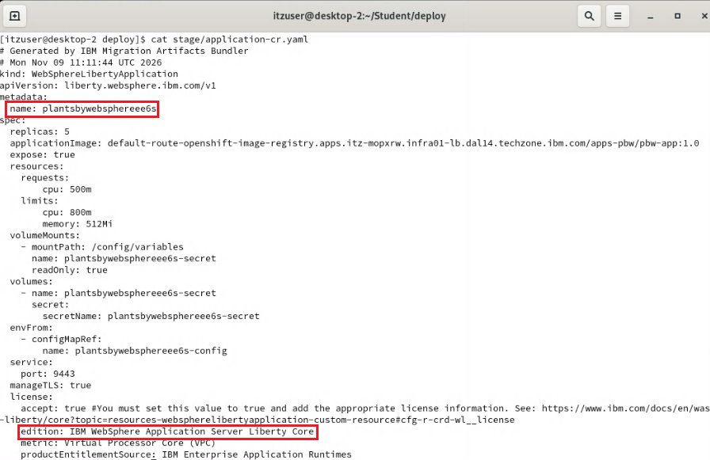

    6. Deploy the second application

           cd ~/Student/deploy
           oc apply -n apps-pbw -f stage/application-cr.yaml

    7. Take a look at the deployment status

           oc get deployments

        You can also use the following command to get more details about the deployment

            oc describe deployment plantsbywebsphereee6s

        Finally take a look at the status of the pods

             oc get pods
        
        Wait until the pods have been created.

    8. Reload the ILS Status page and take a look at the changes.

    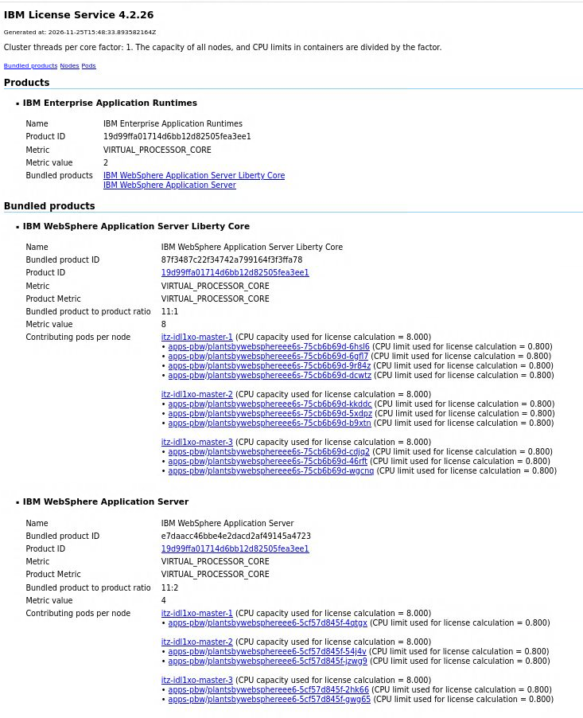
    

    You can find more details about annotations at https://www.ibm.com/docs/en/was-liberty/core?topic=container-tracking-liberty-license-use-in-kubernetes

    

This completes the section about IBM License Service.

You can more details about the Liberty License tracking here:
https://www.ibm.com/docs/en/was-liberty/base?topic=container-tracking-liberty-license-use-in-kubernetes

13. Clean up.

    a. Delete the OCP deployment

        cd ~/Student/migrationPlan/deploy/kustomize/
        oc delete -n apps-pbw -k overlays/staging

    b. Stop the `staging`database.

        sudo podman stop plantsdb-db2-staging

# Summary

___
**Congratulations!**

**You have successfully completed the core learning objectives in the lab**

___

In this lab, you learned how to deploy applications to WebSphere Liberty using the WebSphere Liberty Operator and the deployment artifacts produced by Application Modernization Accelerator in its migration plan.

You explored the options for deployment: 

  - locally running Liberty
  - Liberty as an image running in local container
  - Liberty as an image running in OpenShift.

You learned how to easily configure deployments to OpenShift to allow the same immutable image to be deployed for different configurations such as ‘dev’ and ‘staging’ environment deployments.

You learned about some of the practical ways you can secure your configuration data.

You explored the PlantsByWebSphere assessment details and reports in Application Modernization Accelerator.

___

# Appendix

## Troubleshooting:

### OpenShift related issues

#### oc login fails

Details around how to fix OpenShif login issues

If `oc login -w` fails with an error like

    error: dial tcp: lookup xxx no such host - verify you have provided the correct host and port and that the server is currently running.

this indicates that the OCP endpoint has not been set in the configuration. Try the following command to fix it:

    echo $OCP_CONSOLE_URL

If the command returns no URL, you need to set the URL via these commands:

    cat /usr/local/share/applications/OpenShiftConsole.desktop | grep http > OCP_URL.txt
    OCP_CONSOLE_URL=$(sed 's/Exec=\/usr\/bin\/xdg-open //g' OCP_URL.txt)
    sudo echo "export OCP_CONSOLE_URL=$OCP_CONSOLE_URL" >> ~/.bashrc
    OCP_BASE_URL="${OCP_CONSOLE_URL:34}"
    sudo echo "export OCP_BASE_URL=$OCP_BASE_URL" >> ~/.bashrc

Now you can log in via the command:

    oc login -w --server=$OCP_CONSOLE_URL:6443
    

#### WebSphere Liberty Operator not installed

Details around how to install the WebSphere Liberty Operator into OpenShift

The WebSphere Liberty Operator is installed by default.
But if not, here the  steps to install it.

 

1. Make sure that the ibm-operator-catalog is installed 

        oc get catalogsource -n openshift-marketplace

    The command output lists the installed operators for CatalogSources. Ensure the ibm-operator-catalog is listed.

    a. If the ibm-operator-catalog is not listed, perform the following steps:

    a. Install the ibm-operator-catalog
    
        cat <<EOF | oc apply -n openshift-marketplace -f -
        apiVersion: operators.coreos.com/v1alpha1
        kind: CatalogSource
        metadata:
            name: ibm-operator-catalog
            namespace: openshift-marketplace
        spec:
            displayName: IBM Operator Catalog
            publisher: IBM
            sourceType: grpc
            image: icr.io/cpopen/ibm-operator-catalog:latest
            updateStrategy:
                registryPoll:
                interval: 45m
        EOF

    b. Check that the pods for CatalogSources are running.

       oc get pods -n openshift-marketplace | grep ibm-operator-catalog

        This might take some time, Wait until the pod is running.

    Hint: You can find more details here:
        https://www.ibm.com/docs/en/was-liberty/base?topic=operator-preparing-installation

2. Install the liberty operator 

    1. Specify the namespace and trigger the installation

            WLO_NAMESPACE=openshift-operators
            cat <<EOF | oc apply -f -
            apiVersion: operators.coreos.com/v1alpha1
            kind: Subscription
            metadata:
                name: ibm-websphere-liberty
                namespace: $WLO_NAMESPACE
            spec:
                installPlanApproval: Automatic
                name: ibm-websphere-liberty
                source: ibm-operator-catalog
                sourceNamespace: openshift-marketplace
            EOF

    2. Check if pod wlo-controller-manager is available

            WLO_NAMESPACE=openshift-operators
            oc get pods -n $WLO_NAMESPACE

    3. Check the status of the WebSphere Liberty operator:

            WLO_NAMESPACE=openshift-operators
            oc get operators -n $WLO_NAMESPACE | grep websphere-liberty

    Hint: You can find more details here:
    https://www.ibm.com/docs/en/was-liberty/base?topic=operator-installing-red-hat-openshift-cli

